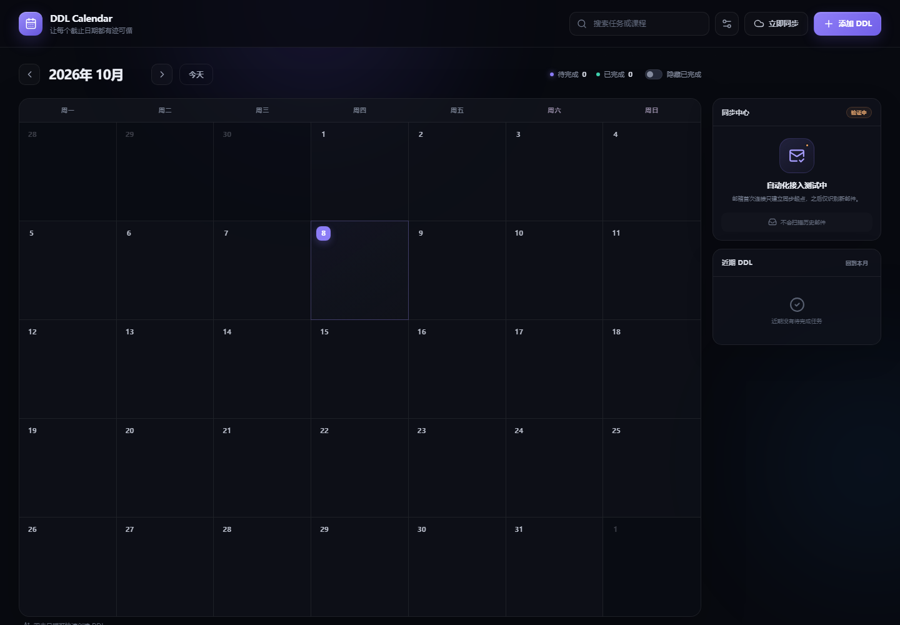
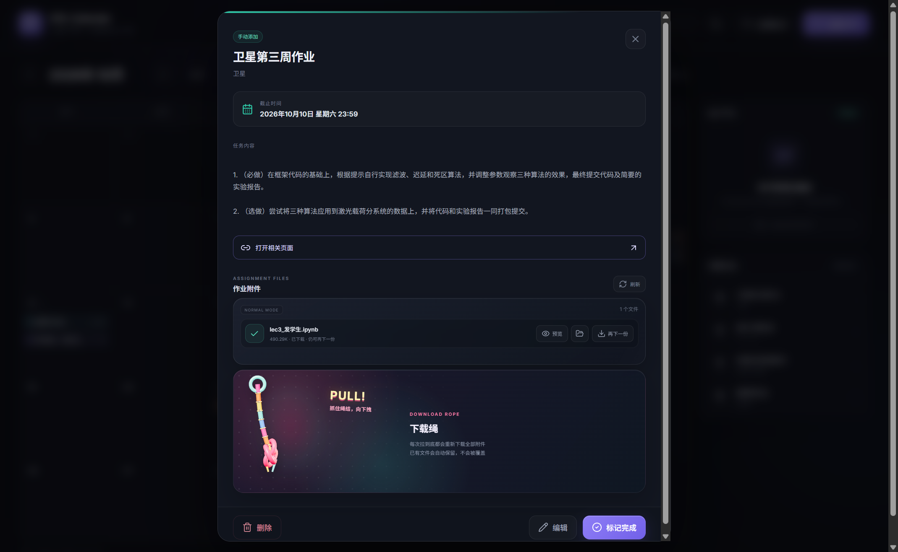

<div align="center">

# DDL Calendar

### 让散落在邮件和网络学堂里的作业，自动回到日历上。

一款为 Windows 11 打造的本地优先桌面 DDL 管理器。  
连接清华邮箱、识别作业通知、补全网络学堂详情与附件，然后把每一个截止日期放进一张安静、清晰的月历。


</div>



## 为什么做它

作业通知在邮箱里，完整说明和附件在网络学堂里，真正需要记住的却只有一件事：**什么时候截止**。

DDL Calendar 把这条流程收拢到一个桌面应用中：新邮件到达后，应用识别固定格式的作业通知，读取网络学堂中的任务说明、截止时间与附件，并直接加入月历。你也可以随时手动添加、编辑或完成任务。

## 亮点功能

| | 功能 | 体验 |
| --- | --- | --- |
| 📅 | **可视化月历** | DDL 直接显示在日期方格中；每格最多展示 3 项，其余内容折叠为“还有 x 项” |
| 📮 | **邮箱增量同步** | 首次连接只记录起点，不翻阅历史邮件；之后只检查新到达的作业通知 |
| 🎓 | **网络学堂补全** | 自动读取作业标题、课程、详细说明、准确截止时间和附件列表 |
| 🪢 | **下载绳** | 拉动彩色绳结下载全部附件，进度越高反馈越强，完成后伴随彩带庆祝 |
| ✍️ | **手动管理** | 添加、编辑、删除、搜索 DDL，支持课程配色与完成状态 |
| 🌙 | **自动检查** | 每天 00:00 检查一次；若当时应用未运行，则在下一次启动时补检 |
| 💾 | **可靠持久化** | 任务、邮箱配置和网络学堂会话跨重启保留，并用备份快照防止空数据覆盖 |
| 🔒 | **本地优先** | 日历数据不上传第三方服务器；敏感凭据由 Windows 加密后保存在本机 |

## 从通知到日历

```text
清华邮箱的新作业通知
          ↓
识别课程、标题与网络学堂链接
          ↓
读取作业说明、截止时间与附件
          ↓
自动加入月历，随时查看或下载
```

> 邮箱首次连接不会导入旧邮件，只会记住当前最新邮件的位置。这样可以避免历史作业一次性涌入日历；已有 DDL 可以手动补充。

## 不只是“下载附件”

详情页会正常列出附件名称、状态以及预览、打开目录、单独下载等操作；想要一点仪式感时，也可以抓住左下角的彩色绳结向下拉，把本次作业的全部附件一次装进口袋。



下载进度会驱动模块的充水、晃动和缩放效果。下载完成后，模块恢复平静并播放彩带反馈。已经下载过的附件仍可再次下载，新文件不会粗暴覆盖旧文件。

## 开始使用

### 环境要求

- Windows 11
- [Node.js](https://nodejs.org/) 20 或更高版本
- [pnpm](https://pnpm.io/) 10 或更高版本

### 本地开发

```powershell
git clone https://github.com/TyperMonkie/Deadline-Calendar.git
cd Deadline-Calendar
pnpm install
pnpm desktop:dev
```

`pnpm dev` 仅启动浏览器界面预览。邮箱、网络学堂和本地文件能力需要使用 `pnpm desktop:dev` 启动桌面版。

### 构建 Windows 安装包

```powershell
pnpm install
pnpm desktop:build
```

安装包会生成在 `release/` 目录中。

## 首次配置

1. 打开右上角的“同步设置”。
2. 填写清华邮箱地址和邮箱客户端专用密码，应用会验证连接并建立增量同步起点。
3. 打开网络学堂登录窗口，完成学校要求的登录或二次认证。
4. 点击“立即同步”。之后应用会在每天午夜或错过午夜后的首次启动时自动检查。

网络学堂会话会跨应用和电脑重启保存；但如果学校服务器主动让会话失效、你修改了密码或手动退出账号，仍需要重新登录一次。

## 数据与隐私

应用的持久数据位于：

```text
%USERPROFILE%\.ddl-calendar\
├── app-data.json          # 日历任务与同步状态
├── app-data.backup.json   # 上一份有效任务快照（产生后存在）
├── mail-config.json       # Windows 加密后的邮箱配置
└── learn-session.json     # Windows 加密后的网络学堂会话
```

- 邮箱通过只读 IMAP 检查新邮件，应用不会发送、移动或删除邮件。
- 邮箱密码和网络学堂会话使用 Electron `safeStorage`，在 Windows 上由 DPAPI 保护。
- 作业附件只允许从受信任的清华网络学堂域名下载，并保存到系统下载目录下的 `DDL Calendar` 文件夹。
- 如果主任务文件损坏，应用会优先读取上一份有效快照；无法确认数据安全时会停止写入，避免用空日历覆盖已有内容。
- 请勿把 `%USERPROFILE%\.ddl-calendar` 中的任何文件提交到版本控制或分享给他人。

## 技术栈

- **桌面容器：** Electron
- **界面：** React + TypeScript + Vite
- **动画与交互：** CSS + Three.js
- **邮件读取：** ImapFlow + MailParser
- **时间处理：** date-fns
- **安装包：** electron-builder / NSIS

## 项目结构

```text
├── electron/        # 桌面主进程、邮件同步、网络学堂与本地数据层
├── src/             # React 界面与交互组件
├── scripts/         # 数据层、邮件和桌面冒烟测试
├── src-tauri/       # 早期桌面实验代码（当前正式构建使用 Electron）
└── package.json     # 开发、构建与打包命令
```

## 当前适用范围

DDL Calendar 目前针对清华大学邮箱和网络学堂的通知格式开发，并非学校官方产品。若学校修改登录流程、邮件模板或作业页面结构，相关自动化可能需要随之更新。

如果这个项目也能让你的 DDL 少一点混乱，欢迎提交 Issue 或 Pull Request。✨
